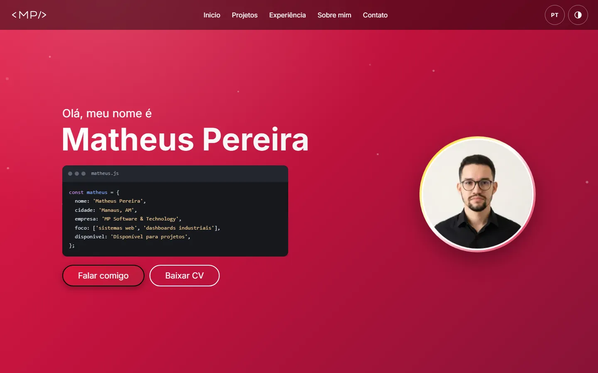
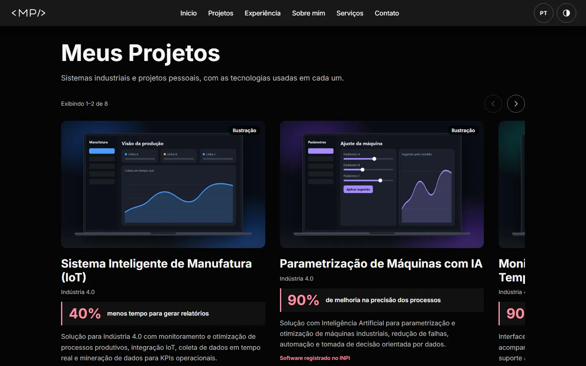
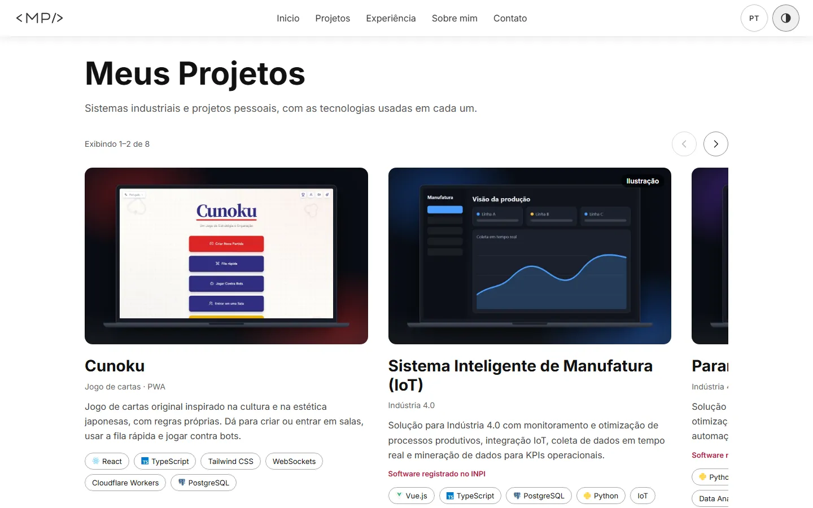
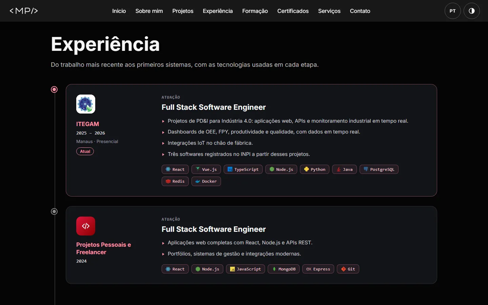
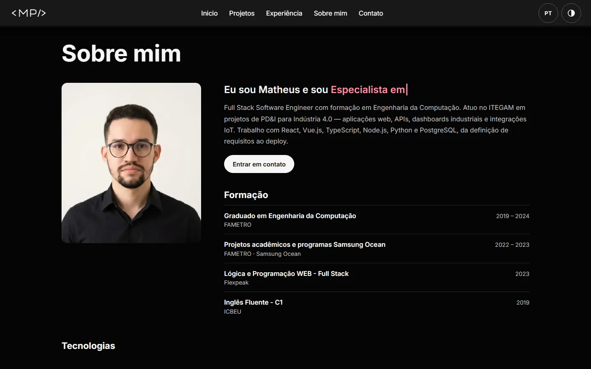
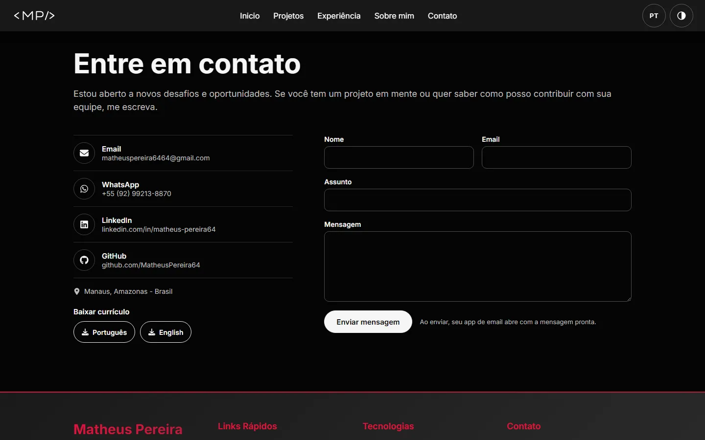
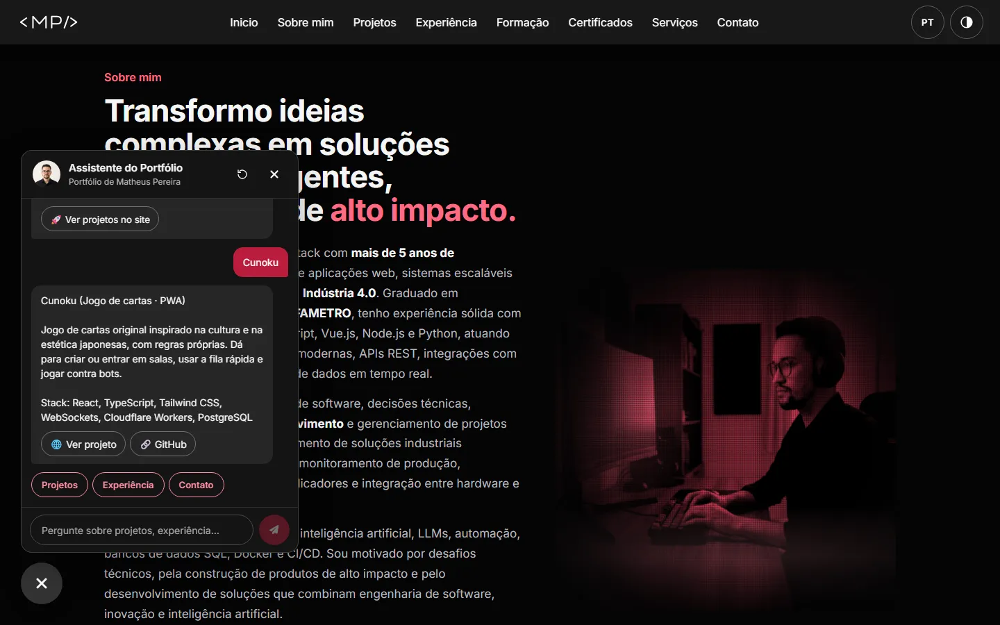
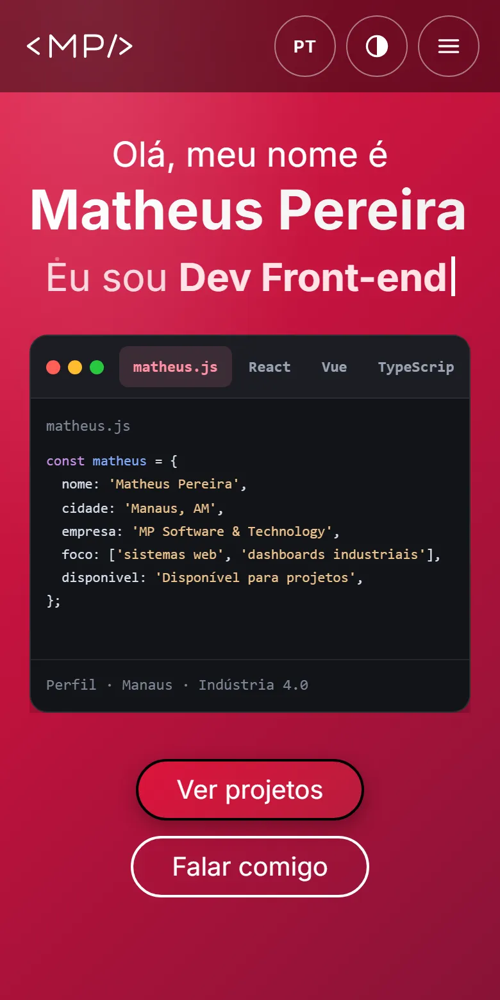
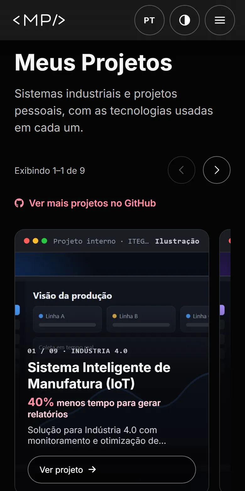
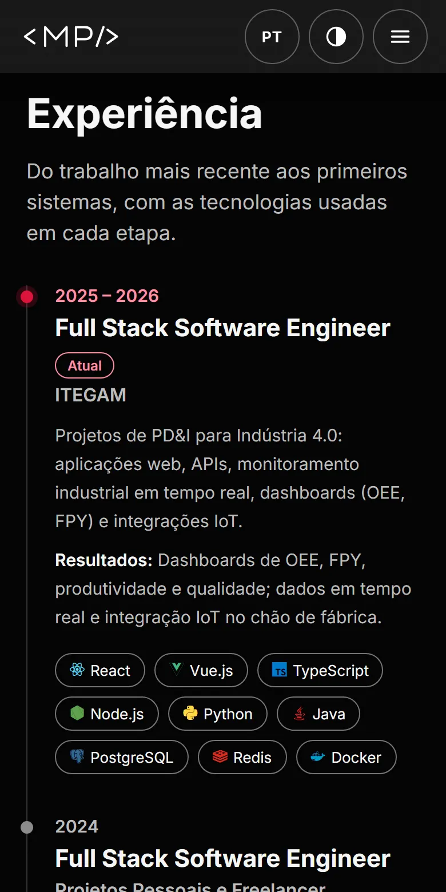

# Portfólio de Matheus Pereira

<div align="center">

[](https://matheuspereira64.github.io/Portfolio/)
[](https://react.dev/)
[](https://vitejs.dev/)

**[matheuspereira64.github.io/Portfolio](https://matheuspereira64.github.io/Portfolio/)**

</div>

Portfólio pessoal em React, com projetos, experiência, formação e contato em português, inglês e espanhol, nos temas claro e escuro.

## 🖼️ Prévias

### Início



### Projetos

Carrossel com contador e setas, botão para o GitHub e, nos projetos com deploy, botão para ver o projeto.



<details>
<summary>Ver no tema claro</summary>



</details>

### Experiência



### Sobre mim e formação



### Contato



### Chatbot



### No celular

<p>
  
  
  
</p>

> As prévias são geradas com `npm run readme:previews`. Nos cartões de projeto, as imagens com o selo "Ilustração" são mocks, não telas reais.

## ✨ Funcionalidades

- **3 idiomas:** português, inglês e espanhol, com seletor acessível por teclado
- **Tema claro e escuro:** segue o sistema e guarda a escolha
- **Projetos:** carrossel com links para GitHub, deploy e estudos de caso
- **Chatbot:** respostas instantâneas sobre projetos, tecnologias, experiência e contato, com IA opcional via proxy
- **Contato:** formulário com validação, enviado por EmailJS ou pelo app de email do visitante
- **Currículo:** download em português e inglês
- **Acessibilidade:** navegação por teclado, foco gerenciado e respeito a `prefers-reduced-motion`
- **Responsivo:** do celular ao desktop

## 📱 Seções

1. **Início:** abertura animada `<MP/>`, apresentação e botões de contato e currículo
2. **Projetos:** carrossel com os projetos em destaque
3. **Experiência:** linha do tempo profissional
4. **Sobre mim:** apresentação, formação, tecnologias e certificações
5. **Serviços:** o que posso construir ou melhorar
6. **Blog:** publicações do LinkedIn, quando houver posts cadastrados
7. **Contato:** canais diretos, currículo e formulário

## 🛠️ Tecnologias

- **React 18** e **Vite 5**
- **CSS** próprio, sem framework
- **Typed.js:** texto digitado na seção Sobre mim
- **react-intersection-observer:** entrada das seções ao rolar
- **EmailJS:** envio do formulário de contato
- **Font Awesome:** ícones
- **Playwright** (só em desenvolvimento): geração de imagens e prévias

## 📦 Instalação

Requer Node.js 20 (a versão usada nos workflows do repositório).

```bash
git clone https://github.com/MatheusPereira64/Portfolio.git
cd Portfolio
npm install
npm run dev
```

O site abre em **`http://localhost:5173/Portfolio/`**.

### Variáveis de ambiente (opcionais)

Copie `.env.example` para `.env` na raiz do repositório.

**Formulário de contato:** crie no [EmailJS](https://www.emailjs.com/) um Service e um Template com os campos `from_name`, `from_email`, `reply_to`, `subject` e `message`. Depois preencha:

```env
VITE_EMAILJS_SERVICE_ID=...
VITE_EMAILJS_TEMPLATE_ID=...
VITE_EMAILJS_PUBLIC_KEY=...
```

Sem EmailJS, o formulário abre o app de email do visitante com a mensagem pronta.

**Chatbot com IA:** funciona só via proxy. Defina `VITE_GEMINI_PROXY_URL` e mantenha a chave no servidor, como em `api/gemini-proxy.example.mjs`. Veja [CHATBOT_SETUP.md](CHATBOT_SETUP.md). Sem proxy, o chatbot usa apenas as respostas instantâneas.

### Scripts

| Comando | O que faz |
|---|---|
| `npm run dev` | Servidor de desenvolvimento |
| `npm run build` | Build de produção em `docs/` |
| `npm run preview` | Serve o build localmente |
| `npm run og:install` | Baixa o Chromium do Playwright (uma vez) |
| `npm run projects:images` | Regenera as imagens dos cartões de projeto |
| `npm run readme:previews` | Regenera as prévias deste README |

## 📁 Estrutura

```
Portfolio/
├── src/
│   ├── components/
│   ├── constants/
│   ├── context/          ← idioma e tema
│   ├── data/             ← projetos, certificações e base do chatbot
│   └── utils/
├── public/               ← imagens, currículos e certificados
├── readme-assets/        ← prévias deste README
├── scripts/              ← geração de imagens
├── api/                  ← exemplo de proxy do chatbot
├── docs/                 ← build de produção
├── .github/workflows/
└── vite.config.js
```

## 🚀 Deploy

O workflow `.github/workflows/deploy-pages.yml` faz o build e publica o site no GitHub Pages a cada push para `main`, `development` ou `feat/react-refactor`. Pushes que alteram apenas `docs/` ou arquivos `.md` não disparam o deploy.

No push para `main`, o workflow `ci.yml` também atualiza a pasta `docs/` com um commit automático.

No GitHub, use **Settings → Pages → Source: GitHub Actions**. Mais opções em [DEPLOY.md](DEPLOY.md).

> Não abra o `index.html` direto no navegador ou com Live Server: o JSX precisa do Vite. Use `npm run dev` ou `npm run preview`.

## 📧 Contato

- **Email:** matheuspereira6464@gmail.com
- **LinkedIn:** [Matheus Pereira](https://www.linkedin.com/in/matheus-pereira64/)
- **Telefone:** +55 (92) 99213-8870

## 📄 Licença

Este projeto está sob a licença MIT. Veja o arquivo [LICENSE](LICENSE) para mais detalhes.

---

**Desenvolvido por Matheus Pereira de Souza**
